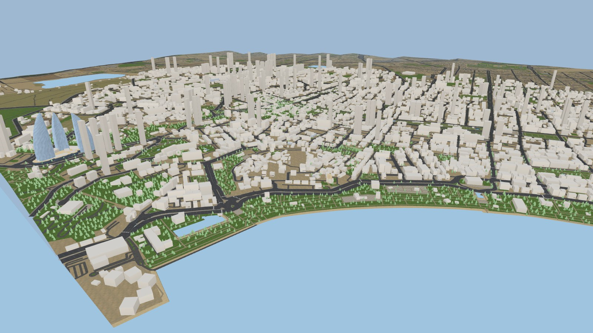
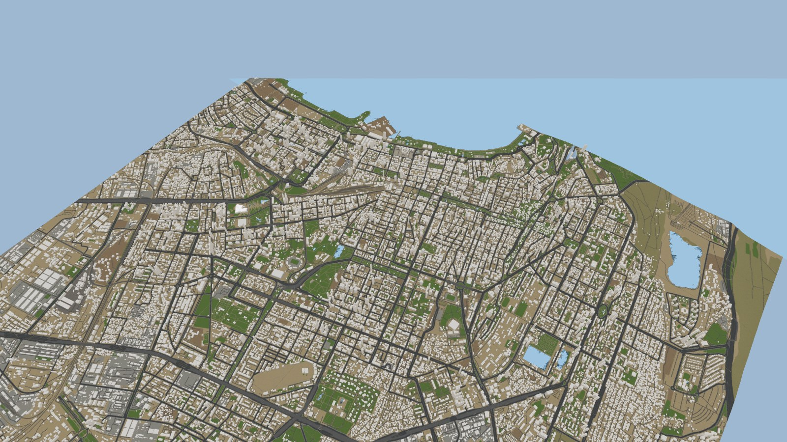
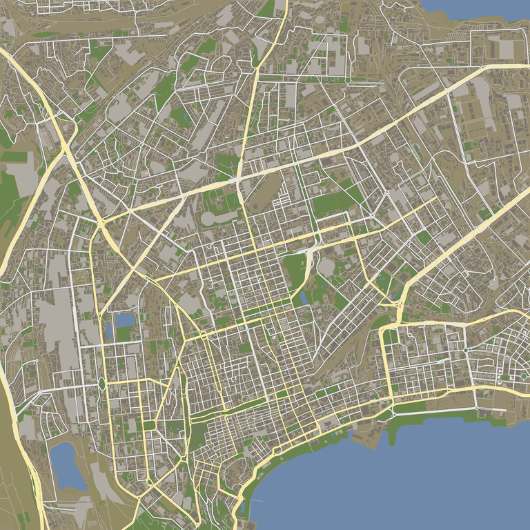
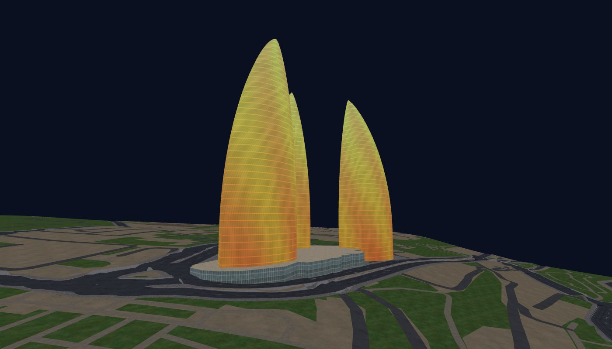
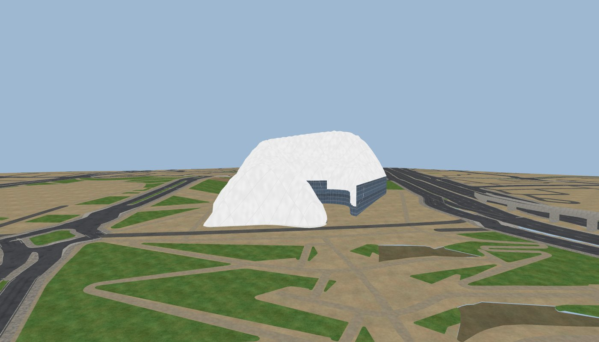
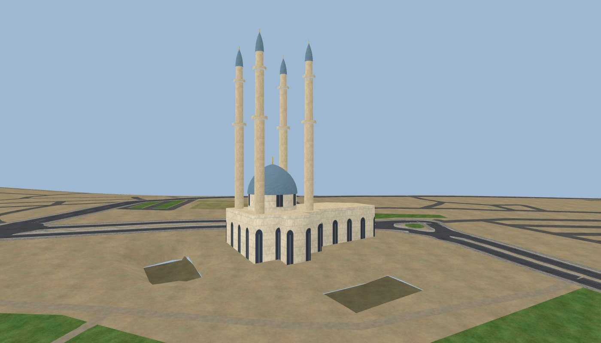
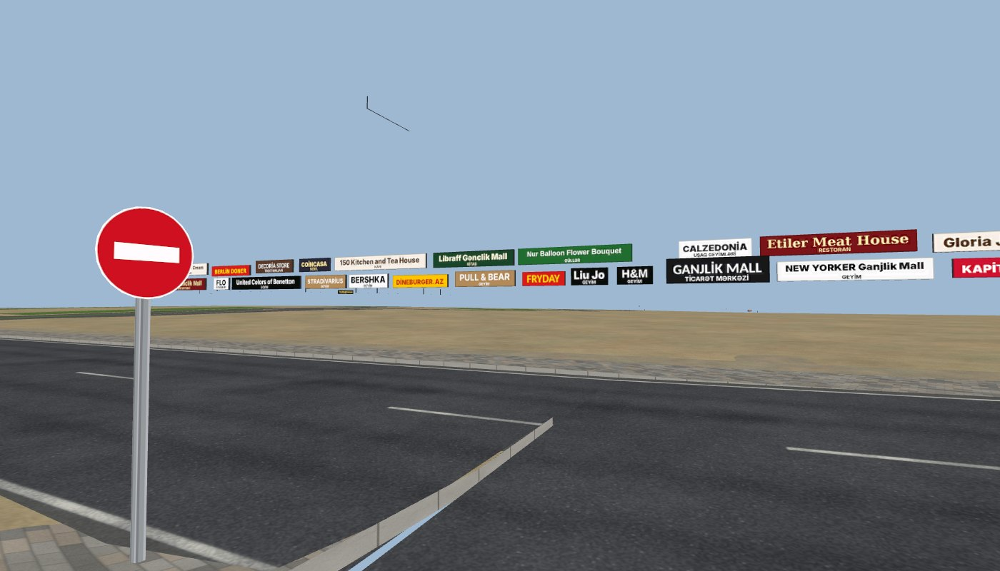

# Bakı — GTA San Andreas üçün xəritə / Baku map for GTA San Andreas

Total-conversion map mod for **GTA San Andreas PC (original 1.0)** that replaces the San Andreas
world with Baku: Biləcəri – 9-cu mikrorayon – Dərnəgül – Nəsimi – Yasamal – 28 May –
Heydər Əliyev Mərkəzi – Ağ Şəhər – Dənizkənarı Bulvar.



| | |
|---|---|
|  |  |
|  |  |
|  |  |

(Renders of the generated map, `tools/preview/aerial.py`. The San Andreas buildings and trees
come from the player's game: in the aerial views they are white boxes / cones of the placed
models' size. / Quşbaxışı şəkillərdə SA binaları və ağacları yerləşdirilmiş modellərin
ölçüsündə ağ qutular / konuslarla göstərilib — oyunda onların yerində SA-nın öz modelləri olur.)

**Yükləmə / Download:** `release/` qovluğundakı `Baku_SA.zip.001, .002 ...` hissələri
(`JOIN_PARTS.bat` və ya 7-Zip ilə birləşdirin), sonra `Baku_SA/INSTALL.bat`.

## Azərbaycanca

* Yol şəbəkəsi, körpülər/estakadalar, tunel girişləri, səkilər — OpenStreetMap məlumatından
  avtomatik qurulur (Overture Maps vasitəsilə), relyef — SRTM hündürlük məlumatından.
* Binalar — GTA San Andreas-ın öz modelləri, Bakının real bina konturlarına ölçüyə görə seçilir
  (perimetr bloklar küçə cəbhəsi boyu doldurulur).
* Görməli yerlər öz modelləri ilə: Heydər Əliyev Mərkəzi, Alov qüllələri (gecə alov kimi işıqlanır),
  Heydər məscidi, Qız qalası.
* Mağaza və market adları (Bravo, Araz, Bazarstore, apteklər, banklar, kafelər ... OSM/Overture
  məlumatından real adlarla), mavi küçə adı lövhələri, zebra keçidləri.
* Azərbaycan yol nişanları (STOP, yol ver, piyada keçidi, giriş qadağandır, sürət həddi, əsas yol,
  dairəvi hərəkət, avtobus dayanacağı, metro "M" ...) — maşın vuranda vanilla nişanlar kimi yıxılır.
* Svetoforlar (AI fazası ilə görünən faza eynidir), küçə işıqları, ağaclar (30 000+), avtobus
  dayanacaqları, skamyalar, həyətlərdə və dayanacaqlarda park olunmuş maşınlar.
* Trafik (maşın + piyada), radar xəritəsi, rayon adları, su (Xəzər, Böyükşor, Qanlı göl),
  sərbəst gəzinti üçün öz `main.scm`.
* Quraşdırma: `dist/Baku_SA/INSTALL.bat` (təfsilat: `tools/install/README_AZ.txt`).

## English

The whole map is generated by the Python pipeline in `tools/`:

| step | module |
|---|---|
| geodata (Overture/OSM, DEM) | `tools/fetch_overture.py`, `tools/fetch_dem.py` |
| projection (scale 0.675, Caspian = z 0) | `tools/geo/proj.py` |
| road graph, lane layout, displacement of over-wide roads | `tools/geo/roads.py` |
| ribbons, junction polygons, sidewalks | `tools/geo/roadmesh.py` |
| terrain + road-aware membrane | `tools/geo/terrain.py`, `tools/geo/profiles.py` |
| tile mesher, structures (viaducts, trenches) | `tools/build/ground.py`, `tools/build/structures.py` |
| procedural textures | `tools/tex/ground_tex.py` |
| SA building placement | `tools/build/buildings.py` (+ catalog `data/sa/`) |
| street furniture, trees, traffic lights (SA models) | `tools/build/props.py` |
| road signs, shop boards, street plates, zebras | `tools/build/signs.py`, `tools/build/signtiles.py`, `tools/tex/signs_tex.py` |
| landmarks (HAC, Flame Towers, Heydar Mosque, Maiden Tower) | `tools/build/landmarks.py`, `tools/tex/landmark_tex.py` |
| parked cars (car generators) | `tools/build/parking.py` |
| AI paths | `tools/build/build_paths.py` → `tools/gta/paths.py` |
| water / zones / radar / scm | `tools/build/build_data.py` → `tools/gta/*.py` |
| RenderWare + GTA formats | `tools/rw/` (DFF, TXD, COL3, IMG), `tools/gta/ipl.py` |
| packaging, validation, installer | `tools/build/package.py`, `tools/validate.py`, `tools/install/` |

Build from scratch (Python 3.13, numpy, shapely 2.2, pyproj, scipy, pillow, pyarrow):

```
python3 tools/fetch_overture.py data/raw && python3 tools/fetch_dem.py data/raw/dem
python3 -m tools.tex.ground_tex build/tex
python3 -c "from tools.build import ground, buildings; import pickle; W=ground.prepare(); pickle.dump(buildings.place_all(W), open('data/cache/buildings.pkl','wb'))"
python3 -m tools.build.build_ground --jobs 4      # ground tiles + LODs (LOD textures show the roofs)
python3 -m tools.build.build_paths
python3 -m tools.build.landmarks && python3 -m tools.build.rail
python3 -m tools.build.props && python3 -m tools.build.build_signs && python3 -m tools.build.parking
python3 -m tools.build.package && python3 -m tools.validate
python3 -m tools.release                          # split zip in release/
```

`tools/validate.py` re-reads the packaged files and checks them against the engine limits of the
original 1.0 executable (no limit adjuster needed). Current build:

| limit (SA 1.0) | Baku, worst case | vanilla, same measure |
|---|---|---|
| building pool 13 000 | 10 668 (3 656 permanent + 6 627 streamed + 385 interiors) | — |
| dummy pool 2 500 (object.dat props loaded at once) | 1 710 | 1 616 + text IPLs |
| double-link sector nodes 3 200 | 2 566 | — |
| car generators 500 (loaded at once) | 440 | 128 + script |
| visible entity list 1 000 (max draw distance, 90° FOV) | 484 | 259 |
| visible LOD list 1 000 | 247 | 642 |
| collision triangles per vehicle sphere (`collTrisB[600]`) | 400 (r = 12), 516 (r = 20) | — |
| IplEntityIndexArrays 40, gpLoadedBuildings 4 096 per text IPL, model info slots 14 000 | 28, 1 152, ~5 400 | — |

Up to a 3 × 3 window of the 500-unit stream cells is loaded at once (IPL bounding box + 350);
the validator simulates it exactly. Details in `docs/notes/props.md`.

Engine research notes (all with sources from the reverse-engineered game code) are in
`docs/notes/`: paths, SCM, data files, SA model catalog, props/signage/landmarks/parked cars
(`props.md`), plus `docs/PLAN.md`.

Data: © OpenStreetMap contributors (ODbL) via Overture Maps; AWS Terrain Tiles.
Fonts in `tools/tex/fonts` (Inter, DejaVu, Liberation, Carlito) keep their own licences (OFL /
Bitstream Vera), see the LICENSE files next to them.
GTA San Andreas models are © Rockstar Games and are not redistributed — the mod references the
files of the player's own game.
